# 🎙️ Awesome AI Meeting Assistants

### Curated Directory of SaaS Platforms, Local-First Models & Open-Source Meeting Copilots

  
  
  
  
  
  
  
  

**Keywords:** *AI Meeting Assistant, Real-Time Transcription, Speech-to-Text, Whisper AI, Meeting Minutes Summarization, Action Items Extraction, On-Device AI, Stealth Interview Copilot, Conversation Intelligence, Zoom Google Meet Microsoft Teams Bots, Self-Hosted Transcription.*

---

## 📖 Introduction & Overview

Welcome to **Awesome AI Meeting Assistants** — the most comprehensive, battle-tested directory of **cloud SaaS platforms** and **open-source developer projects** transforming business communication, audio intelligence, and live meeting workflows.

These tools empower professionals, developers, candidates, and privacy-conscious teams to:
- ⚡ **Capture & Transcribe**: Real-time multi-speaker diarization and sub-second speech-to-text.
- 📝 **Automate Summaries**: Generate action items, executive meeting minutes, and follow-up emails.
- 🔒 **Local-First Privacy**: Run transcription entirely on-device via Whisper, Parakeet, or Ollama without external bots joining calls or audio leaving your machine.
- 🥷 **Stealth Live Guidance**: Overlay invisible copilots with local RAG memory and context teleprompters for technical interviews and sales presentations.

---

## 📑 Table of Contents

- [📊 Sector Overview & Market Dynamics](#sector-overview--market-dynamics)
- [☁️ SaaS/Hosted Platforms](#saas-hosted-platforms)
- [💻 Open-Source GitHub Projects](#open-source-github-projects)
- [📦 Open-Source Libraries, CLI Tools & MCP Servers](#open-source-libraries-cli-tools--mcp-servers)
- [🤝 How to Contribute](#how-to-contribute)
- [⭐ Star History](#star-history)
- [💖 Support & Sponsoring](#support)
- [⚠️ Disclaimer](#disclaimer)

---

## 📊 Sector Overview & Market Dynamics

- **Estimated Market Size**: The global AI meeting assistant and speech-to-text transcription software market was valued at approximately **$2.8 billion to $3.5 billion in 2024–2025**, and is projected to expand beyond **$10 billion by 2030** at an estimated compound annual growth rate (CAGR) of **25%–28%**.
- **Market Structure & Fragmentation**: The sector is **moderately fragmented** rather than a winner-take-all monopoly. While video platform incumbents (Microsoft Teams Copilot, Zoom AI Companion) capture baseline corporate meeting recording, independent SaaS leaders (Otter.ai, Fireflies.ai, Read AI) thrive through cross-platform calendar flexibility, specialized sales/revenue intelligence (Avoma), and viral product-led free tiers (Fathom). Concurrently, rapid innovation in local Whisper inference has fueled a surging **local-first and open-source ecosystem** (Meetily, Screenpipe, Natively) that bypasses vendor subscriptions and preserves sensitive corporate privacy.

---

## ☁️ SaaS/Hosted Platforms

The table below benchmarks the leading commercial AI meeting assistants, sorted in descending order by **Company Scale / Valuation / Revenue**:

| Platform | Company Scale / Valuation | Starting Price (Paid Tier) | Free Tier Limit (Specific) | Key Highlights & Core Capabilities |
| :--- | :--- | :--- | :--- | :--- |
| **[Fireflies.ai](https://fireflies.ai/)** | **~$1.0B Valuation** *(Unicorn status, $19M funding)* | **$10/user/mo** *(Billed annually at $120/yr, or $18/mo billed monthly)* | **Free Forever Plan**: • 800 minutes storage / account • Up to 3 transcription credits/mo • Basic AI summaries & keyword search | Multi-platform meeting bots (Zoom, Meet, Teams, Webex), soundbite sharing, CRM & workspace integration, conversation analytics. |
| **[Read AI](https://www.read.ai/)** | **~$430M Valuation** *($81M total funding)* | **$15/user/mo** *(Billed annually at $180/yr, or $19.75/mo billed monthly)* | **Free Forever Plan**: • 5 meeting reports per month • Real-time video engagement metrics • Standard transcripts & AI summaries | Automated meeting recaps, live participant engagement & sentiment scores, speaker pacing coaching, cross-platform calendar sync. |
| **[Otter.ai](https://otter.ai/)** | **$100M+ ARR** *(~$250M valuation, $73M funding)* | **$8.33/user/mo** *(Billed annually at $100/yr, or $16.99/mo billed monthly)* | **Free Forever Plan**: • 300 transcription mins/month • Max 30 mins per conversation • 3 lifetime audio/video file imports | Category leader with real-time streaming transcription, OtterPilot auto-join, live slide screenshot capture, automated action item extraction. |
| **[Fathom](https://fathom.video/)** | **~$73M Valuation** *($30M ARR, Acquired by Superhuman)* | **$15/user/mo** *(Billed annually at $180/yr, or $19/mo billed monthly)* | **Free Forever Plan**: • **100% Free Unlimited** recording & transcription for solo users • Unlimited instant AI summaries • Manual action items | Most generous free tier in the category, zero post-meeting processing wait times, native CRM sync (Salesforce, HubSpot), video clip highlights. |
| **[Avoma](https://www.avoma.com/)** | **~$15M Funding Raised** *(Venture-backed Series A)* | **$19/user/mo** *(Billed annually at $228/yr, or $24/mo billed monthly)* | **14-day Free Trial**: • Full access to AI meeting recording & notes • Free tier thereafter offers scheduling & manual notes only | Revenue intelligence focus, conversation analytics, pipeline deal risk alerts, automated CRM field updating, customized meeting agenda templates. |
| **[Supernormal](https://supernormal.com/)** | **~$12.9M Funding Raised** *(Balderton Capital, EQT Ventures)* | **$20/month** *(Team starter pack for 1,000 mins/mo, or $40/mo Business)* | **Free Forever Plan**: • 10 meetings per month • Capped at 200 total monthly minutes • Standard AI meeting notes | Executive-ready structured notes, customizable markdown templates, desktop audio capture, slide & document generation, multi-language support. |
| **[tl;dv](https://tldv.io/)** | **~$4.5M Funding Raised** *(Seed round led by K Fund)* | **$18/user/mo** *(Billed annually at $216/yr, or $29/mo billed monthly)* | **Free Forever Plan**: • Unlimited video recording & transcription • 10 AI summaries per month • 3-month history storage | High-accuracy multi-lingual transcription (25+ languages), video timestamps, snippet clipping, deep integration with Notion, Slack, and HubSpot. |
| **[MeetGeek](https://meetgeek.ai/)** | **~$2.8M Funding Raised** *(Seed stage, Early Game Ventures)* | **$9.99/user/mo** *(Billed annually at $119.88/yr, or $13.30/mo billed monthly)* | **Free Forever Plan**: • 3 hours of transcription per month • 3 months of audio storage • Basic AI meeting highlights | Automated recording bot, meeting health & attendance metrics, keyword/KPI tracking, automatic video highlight reels sent to team channels. |
| **[Jamie AI](https://www.meetjamie.ai/)** | **~$2.4M ARR** *(European VC-backed)* | **€25/month (~$27/mo)** *(Plus plan for 20 meetings/mo up to 2h/meeting)* | **Free Forever Plan**: • 10 AI meeting notes per month • Meetings capped at 30 minutes each • Bot-free local desktop capture | Privacy-first architecture: operates natively on macOS/Windows without bots joining calls; GDPR-compliant, on-device audio capture for in-person and online calls. |
| **[Sembly AI](https://www.sembly.ai/)** | **~$1.2M Funding Raised** *(Seed round & retail crowdfunding)* | **$10/user/mo** *(Billed annually at $120/yr, or $15/mo billed monthly)* | **Free Forever Plan**: • 4 hours audio transcription/month • 1 hour maximum per call • 7-day trial of multi-meeting agent queries | Multi-agent productivity system, automated formal Minutes of Meeting (MoM), task assignment tracking, proxy attendee capability to record in your absence. |

---

## 💻 Open-Source GitHub Projects

Explore verified, open-source meeting assistants, local transcription engines, and stealth interview copilots. Repositories are sorted in **descending order by GitHub Stars_Count**:

- ### 1. **[Meetily (Zackriya-Solutions/meetily)](https://github.com/Zackriya-Solutions/meetily)** 
  **The #1 Self-Hosted, Open-Source AI Meeting Note Taker for macOS & Windows.**
  - **100% Local & Privacy-First**: On-device processing ensures zero audio or transcripts leave your machine.
  - **High-Speed Transcription**: 4× faster Parakeet and local Whisper live speech-to-text.
  - **Speaker Diarization & Summaries**: Integrated speaker identification and local Ollama summarization. Built in Rust for maximum memory efficiency.

- ### 2. **[Screenpipe (screenpipe/screenpipe)](https://github.com/screenpipe/screenpipe)** 
  **24/7 Desktop Audio & Screen Capture Engine for Real-Time Context & Meeting Intelligence.**
  - **Continuous Local Capture**: Records screen and system/microphone audio locally without cloud dependencies.
  - **Meeting Intelligence & RAG**: Automatically indexes meetings into searchable vector memory for immediate retrieval.
  - **Agent Ecosystem**: Seamlessly pipe live audio transcripts into Claude, ChatGPT, or local LLMs via MCP.

- ### 3. **[Ghost Pepper (matthartman/ghost-pepper)](https://github.com/matthartman/ghost-pepper)** 
  **100% Private On-Device Voice Models for Speech-to-Text & Meeting Transcription on macOS.**
  - **Zero Cloud Footprint**: Runs optimized on-device voice models natively on Apple Silicon.
  - **Live Audio Capture**: Transcribes live meetings directly from mic and system sound card.
  - **Clean Markdown Output**: Produces structured meeting transcripts and action item breakdowns.

- ### 4. **[Natively (Natively-AI-assistant/natively-cluely-ai-assistant)](https://github.com/Natively-AI-assistant/natively-cluely-ai-assistant)** 
  **Feature-Complete Open-Source AI Meeting Assistant, Interview Copilot & Note Taker.**
  - **Auto Answer Engine**: Live answers appear automatically when the speaker finishes questions, backed by follow-up memory.
  - **Stealth Overlay & Teleprompter**: Transparent overlay invisible to screen-sharing software (Zoom, Teams, Meet).
  - **Extensible Integration**: Supports NVIDIA NIM streaming STT, LiteLLM model picker, local RAG memory, and Chrome companion extension.

- ### 5. **[Vexa (Vexa-ai/vexa)](https://github.com/Vexa-ai/vexa)** 
  **Open-Source Meeting Transcription API for Google Meet, Microsoft Teams & Zoom.**
  - **Auto-Join Meeting Bots**: Headless bots join scheduled or impromptu conference calls.
  - **Real-Time WebSockets**: Streams live audio transcription via WebSockets with minimal latency.
  - **MCP Server Ready**: Built-in Model Context Protocol server enabling AI agents to listen and act in meetings.

- ### 6. **[Muesli (Muesli-HQ/muesli)](https://github.com/Muesli-HQ/muesli)** 
  **Agent-Native Local Meeting Transcription & Dictation for macOS.**
  - **Granola & WisprFlow Alternative**: Free, open-source alternative for high-speed voice notes and meeting recaps.
  - **Native Performance**: Lightweight macOS application utilizing on-device speech processing for instant notes.

- ### 7. **[Clueless (vijaythecoder/clueless)](https://github.com/vijaythecoder/clueless)** 
  **Open-Source Desktop AI Meeting Assistant & Interview Helper.**
  - **Live Audio Streaming**: Captures microphone and speaker audio for real-time LLM prompting.
  - **Simple Setup**: Straightforward Electron & Node.js architecture with customizable LLM backends.

- ### 8. **[OffMute (SouthBridgeAI/offmute)](https://github.com/SouthBridgeAI/offmute)** 
  **Experimental Meeting Transcription & Speaker Diarization Powered by LLMs.**
  - **LLM Diarization**: Innovative approach performing transcription and speaker separation through structured LLM prompts.
  - **Action Insights**: Direct extraction of executive decisions, takeaways, and follow-ups.

- ### 9. **[Millet (pretyflaco/millet)](https://github.com/pretyflaco/millet)** 
  **Fully Local Meeting Transcription with Speaker Diarization & PDF Summaries.**
  - **Local Whisper Pipeline**: Self-contained pipeline running local speech models without external API keys.
  - **Document Generation**: Automatically formats transcripts into structured, sharable PDF documents.

- ### 10. **[MeetingCopilot (JWM0203/MeetingCopilot)](https://github.com/JWM0203/MeetingCopilot)** 
  **Real-Time Stealth Meeting & Interview Copilot for Windows.**
  - **Dual Streaming ASR**: Supports local FunASR or cloud models with first-person teleprompter answers.
  - **Screen-Share Invisibility**: Specialized window flags ensure the assistant stays hidden during screen sharing.

- ### 11. **[OpenAI Realtime Meeting Assistant (openai/openai-realtime-meeting-assistant)](https://github.com/openai/openai-realtime-meeting-assistant)** 
  **Official OpenAI Reference Architecture for Interactive Meeting Assistants.**
  - **Realtime API Demonstration**: Demonstrates two-way live audio conversation and real-time transcription.
  - **Automated Kanban Management**: Automatically converts spoken action items into updated project cards.

- ### 12. **[Prismical (amicalhq/prismical)](https://github.com/amicalhq/prismical)** 
  **Open-Source AI Note Taker for Meetings, Lectures & Voice Notes (MIT).**
  - **whisper.cpp Engine**: Fast on-device transcription with zero cloud dependency.
  - **Full-Text Vector Search**: Instant search across historical meetings and notes.
  - **MCP Integration**: Connect notes directly to Claude, ChatGPT, and Cursor.

- ### 13. **[MeetingBro (armpro24-blip/MeetingBro)](https://github.com/armpro24-blip/MeetingBro)** 
  **Local-First AI Meeting Assistant with Real-Time Multi-Language Translation.**
  - **Direct System Capture**: Captures system audio directly without platform plugins or bots.
  - **Dynamic Resource Modes**: Summary-only, Balanced, and Performance modes for low-power or GPU rigs.

- ### 14. **[Pika (royisme/pikabaka)](https://github.com/royisme/pikabaka)** 
  **Open-Source AI Interview Copilot & Meeting Assistant (AGPL-3.0).**
  - **Sub-500ms Transcription**: Rust native audio module (cpal + WebRTC VAD + rubato resampling).
  - **Local RAG Memory**: Past meetings indexed with `sqlite-vec` for instantaneous on-device query retrieval.
  - **Stealth Overlay**: Disguised process name and screen-share bypass for macOS & Windows.

- ### 15. **[IA-notetaking (Igor-C-Assuncao/IA-notetaking)](https://github.com/Igor-C-Assuncao/IA-notetaking)** 
  **Floating Widget AI Meeting Assistant Powered by Tauri v2, WhisperX & LangGraph.**
  - **Modular Architecture**: Audio Mixer → Silero VAD → WhisperX → LangGraph Agent pipeline.
  - **BYOK System**: Pluggable strategies for Ollama, OpenAI, Anthropic, and Gemini.

- ### 16. **[ai-meeting-saas (vivekkushalch/ai-meeting-saas)](https://github.com/vivekkushalch/ai-meeting-saas)** 
  **Self-Hosted Full-Stack Meeting Transcription & Summarization Microservices.**
  - **Modern Stack**: Next.js 16 frontend, FastAPI gateway, and Python Celery distributed worker queue.
  - **Storage Isolation**: Presigned direct uploads to MinIO with HMAC-SHA256 signature verification.

---

## 📦 Open-Source Libraries, CLI Tools & MCP Servers

Specialized open-source developer tools, package managers, and MCP servers:

- **[Freely (NPM)](https://www.npmjs.com/package/freely)**: AI screen assistant with local Whisper STT, screen-capture exclusion on Windows, dual-window floating overlay, and zero cloud sync.
- **[bee-recorder (PyPI)](https://pypi.org/project/bee-recorder/)**: Privacy-first meeting recorder with local Whisper transcription, SpeechBrain speaker diarization, device-change stitching, and ~3.7× real-time processing.
- **[Meeting MCP Server (workos-meeting-mcp-server)](https://pypi.org/project/workos-meeting-mcp-server/)**: Independent MCP server for local audio/video transcription via faster-whisper, extracting structured decisions, markdown notes, and follow-up emails in Cursor, Claude Desktop, and Windsurf.
- **[meeting-cli (@gabrielcraveiro)](https://www.npmjs.com/package/@gabrielcraveiro/meeting-cli)**: CLI tool capturing WASAPI audio on WSL2 & Windows, generating auto-insights and markdown summaries into Obsidian vaults.
- **[pi-notetaker (@dvrosalesm)](https://www.npmjs.com/package/@dvrosalesm/pi-notetaker)**: Offline meeting notes extension for cmd0 desktop agent with conversational LLM-callable meeting management tools.

---

## 🤝 How to Contribute

Contributions are welcome! Help keep this directory current, accurate, and useful for the global developer community:

1. 🍴 **Fork the repository** on GitHub.
2. 📝 **Add or update an entry** in `README.md` following the established table or list format.
3. 🔍 **Provide specific data**: Exact pricing tiers, concrete free tier limits, verified links, and Stars_Badges.
4. 🚀 **Submit a Pull Request** with a brief summary of the project and why it belongs in the ecosystem.

Please refer to [Awesome-Awesome-Awesome](https://github.com/ishandutta2007/Awesome-Awesome-Awesome) for overarching curation standards.

---

## ⭐ Star History

---

## 💖 Support & Sponsoring

Thank you for visiting and utilizing **Awesome AI Meeting Assistants**! If this repository has saved you time researching tools, helped you benchmark pricing, or assisted you in building private local meeting workflows:

- ⭐ **Star this repository** to show your appreciation and boost its visibility!
- 🍴 **Fork and share** with colleagues, engineering teams, and community forums.
- ☕ **Sponsor / Buy Me a Coffee**: Help fund maintenance, automated star tracking, and research on new local models via the [GitHub Sponsors Dashboard](https://github.com/sponsors/ishandutta2007).

---

## ⚠️ Disclaimer & Ethical Guidance

- 🌐 **Community Curation**: This is a community-maintained index for informational and research purposes. Inclusion does not imply commercial endorsement.
- ⚖️ **Consent & Legal Compliance**: Recording audio during meetings is governed by strict wiretapping laws (e.g., one-party vs. two-party/all-party consent jurisdictions) and data privacy regulations (GDPR, CCPA, HIPAA). **Always notify participants and obtain necessary legal consent before recording or transcribing conversations.**
- 🔒 **Privacy Advantages of Local-First AI**: Tools utilizing local Whisper, Parakeet, or Ollama architectures (such as Meetily, Screenpipe, and Prismical) process audio entirely on-device, preventing confidential corporate discussions or intellectual property from being exposed to third-party cloud servers.
- 🛑 **Ethical Use of Stealth Modes**: Certain tools offer screen-share invisibility or teleprompter assistance. Utilizing stealth software to deceive interviewers, employers, clients, or court proceedings may violate employment agreements, codes of ethics, and terms of service. These tools are recommended strictly for accessibility, personal interview practice, memory assistance, and legitimate productivity augmentation.

---

**Made with ❤️ for professionals, developers, and researchers building transparent, private meeting AI solutions.**

